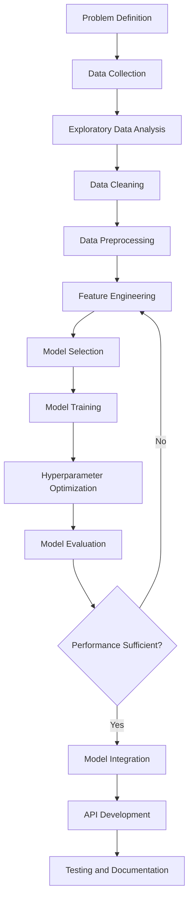

# Hi there, I'm Merve Söğürtlüpınar 👋

### Software Engineering Student
### Artificial Intelligence | Machine Learning | Data Science | Computer Vision

*Transforming data into meaningful insights and intelligent solutions.*

)

---

## 👩‍💻 About Me

I am a Software Engineering student at the Faculty of Technology, Fırat University, with a strong interest in Artificial Intelligence, Machine Learning, Data Science, and Computer Vision.

Throughout my undergraduate education, I have developed academic and individual projects across various engineering disciplines, combining theoretical knowledge with practical applications.

My technical journey focuses on understanding data, developing machine learning models, building intelligent systems, and applying software engineering principles to real-world problems.

Through my internship experiences at Khenda and PiA (People in Action), I have gained practical experience in industrial computer vision, AI training dataset development, data quality assurance, software testing, and test automation.

- 🎓 Software Engineering — Fırat University, Faculty of Technology
- 🤖 Passionate about Artificial Intelligence and Machine Learning
- 📊 Interested in Data Science and Predictive Analytics
- 👁️ Exploring Computer Vision and Digital Image Processing
- 🔬 Interested in research and development projects
- 💻 Developing end-to-end machine learning applications
- 🌱 Committed to continuous learning and professional development
- 💼 Open to AI, ML, Data Science, and R&D internship opportunities

---

## 🎯 Career Objectives

My career goal is to specialize in Artificial Intelligence and Data Science and contribute to innovative, research-oriented engineering projects.

I aim to develop scalable and reliable data-driven solutions by combining machine learning methodologies with strong software engineering practices.

My long-term objectives include:

- Developing intelligent systems for real-world applications.
- Building end-to-end machine learning solutions.
- Specializing in Computer Vision and Deep Learning.
- Contributing to research and development projects.
- Improving my knowledge of model deployment and MLOps.
- Participating in multidisciplinary engineering projects.

---

## 🛠️ Technical Skills & Technologies

### Programming Languages

### Data Science & Data Analysis

- Exploratory Data Analysis (EDA)
- Data Cleaning and Preprocessing
- Missing Value Management
- Numerical and Categorical Feature Analysis
- Feature Engineering and Feature Selection
- Data Visualization
- Statistical Data Analysis

### Machine Learning

- Supervised and Unsupervised Learning
- Classification and Regression
- Linear and Polynomial Regression
- Random Forest
- XGBoost
- K-Means Clustering
- Hyperparameter Optimization
- Cross-Validation
- Machine Learning Pipelines
- Model Evaluation and Performance Analysis

### Computer Vision & Image Processing

- Digital Image Processing
- Image Preprocessing
- Image Segmentation
- Temporal Video Segmentation
- Hierarchical Action Annotation
- Training Dataset Development
- Ground-Truth Data Preparation
- Data Quality Assurance
- Satellite Image Analysis
- Thresholding and Morphological Operations

### Backend Development & Databases

- REST API Development
- Machine Learning API Integration
- Relational Database Design
- Database Management
- Object-Oriented Programming

### Software Testing & Quality Assurance

- REST API Testing
- Functional Testing
- UI Test Automation
- Test Scenario Development
- Response Validation
- Debugging and Quality Assurance

### Development Tools & Platforms

---

## 💼 Professional Experience

### AI & Computer Vision Intern — Khenda

**July 2026 – August 2026 | Istanbul, Türkiye**

Contributed to training dataset development and data quality assurance processes for industrial artificial intelligence and computer vision systems.

**Responsibilities and Technical Experience:**

- Analyzed operator micro-movements in manufacturing videos.
- Performed timestamp-based temporal video segmentation.
- Classified operator activities according to hierarchical action taxonomies.
- Prepared structured ground-truth datasets for AI model training.
- Conducted annotation consistency and timestamp accuracy checks.
- Identified non-value-added activities within manufacturing processes.
- Contributed to industrial computer vision data preparation workflows.

**Key Skills:**

Computer Vision · Artificial Intelligence · Data Annotation · Video Segmentation · Data Quality Assurance · Lean Manufacturing

### Software Test Automation Intern — PiA (People in Action)

**July 2025 – August 2025 | Erzincan, Türkiye**

Gained practical experience in software quality assurance, REST API testing, and automated user interface testing.

**Responsibilities and Technical Experience:**

- Developed REST API test scenarios using Postman.
- Performed CRUD operations and authentication testing.
- Implemented automated API testing workflows.
- Developed UI test scenarios using Selenium WebDriver.
- Applied Java and TestNG for test automation.
- Conducted response validation, assertions, and debugging.
- Tested functional workflows in e-commerce applications.

**Technologies:**

Java · Selenium WebDriver · TestNG · Postman · REST API · JSON

---

## 🚀 Featured Projects

### 01 — End-to-End Credit Risk Prediction

An end-to-end machine learning project focused on predicting credit risk and supporting data-driven financial decision-making.

**Project Highlights:**

- Data cleaning and preprocessing
- Exploratory data analysis
- Feature engineering
- Classification model development
- XGBoost-based predictive modeling
- Hyperparameter optimization
- Machine learning pipeline development
- FastAPI integration

**Technologies:** Python, Pandas, NumPy, Scikit-learn, XGBoost, FastAPI

---

### 02 — E-Commerce Shipping Delay Predictor

A machine learning application designed to predict potential shipping delays in e-commerce logistics operations.

**Project Highlights:**

- E-commerce logistics data analysis
- Data preprocessing and feature engineering
- Random Forest classification
- GridSearchCV-based model optimization
- Model performance evaluation
- Machine learning prediction pipeline
- FastAPI integration

**Technologies:** Python, Pandas, Scikit-learn, Random Forest, FastAPI

---

### 03 — Data Preprocessing & Machine Learning Full Pipeline

A machine learning study covering essential stages of data preparation, analysis, model development, and evaluation.

**Project Highlights:**

- Missing value analysis
- Numerical and categorical data processing
- Feature selection
- Correlation analysis
- Data transformation and scaling
- Machine learning model development
- Performance evaluation

**Technologies:** Python, NumPy, Pandas, Scikit-learn, Jupyter Notebook

---

### 04 — Cultivation: Grow Your Self

A personal development and life management platform designed to support personal growth, productivity, and daily activity management.

**Project Scope:**

- Daily activity management
- Habit tracking
- Personal goal management
- Progress visualization
- Personalized user experience
- AI-powered recommendation system (planned)
- Web and mobile application development (planned)

---

## ⚙️ My Machine Learning Workflow

My approach to machine learning projects focuses on combining data science methodologies with software engineering practices.

I aim to build reproducible, modular, understandable, and well-documented machine learning solutions.

---

## 🔭 Current Project

### Lake Water Surface Detection & Environmental Change Analysis

An ongoing academic project focused on detecting lake water surfaces and monitoring environmental changes using Sentinel-2 satellite imagery.

**Study Areas:**

- Burdur Lake
- Salt Lake (Tuz Gölü)
- Akşehir Lake

**Planned Methodology:**

- Sentinel-2 satellite image processing
- NDWI and MNDWI spectral indices
- Image preprocessing and cloud masking
- Fixed thresholding
- Otsu thresholding
- Adaptive thresholding
- K-Means clustering
- Morphological image processing
- Water surface area calculation
- Temporal environmental change analysis
- Evaluation using IoU, Dice Score, and area error

**Project Objective:**

To compare classical image processing methods for satellite-based water surface extraction and environmental monitoring.

**Status:** In Development

---

## 🌱 Currently Learning

I am continuously improving my knowledge and practical skills in:

- Advanced Machine Learning
- Deep Learning Fundamentals
- Computer Vision Algorithms
- Model Optimization
- Satellite Image Processing
- Remote Sensing
- Geospatial Data Analysis
- Machine Learning Deployment
- MLOps Fundamentals
- Scalable AI Systems

---

## 🔬 Research Interests

- Artificial Intelligence
- Machine Learning
- Deep Learning
- Computer Vision
- Digital Image Processing
- Human Action Recognition
- Industrial Artificial Intelligence
- Predictive Analytics
- Anomaly Detection
- Remote Sensing
- Environmental Data Analysis
- End-to-End Machine Learning Systems

---

## 🧩 Engineering Principles

I believe effective engineering solutions should be:

- Data-driven
- Reproducible
- Modular and maintainable
- Well-documented
- Reliable and testable
- Focused on real-world problems
- Open to continuous improvement

---

## 📊 GitHub Statistics

---

## 🤝 Open to Opportunities

I am interested in internship opportunities, research projects, technical collaborations, and professional networking in:

- Artificial Intelligence
- Machine Learning
- Data Science
- Computer Vision
- Research and Development
- AI Engineering

---

## 📫 Connect with Me

---

### Thank you for visiting my profile!

*Always learning, always building, always improving.*

